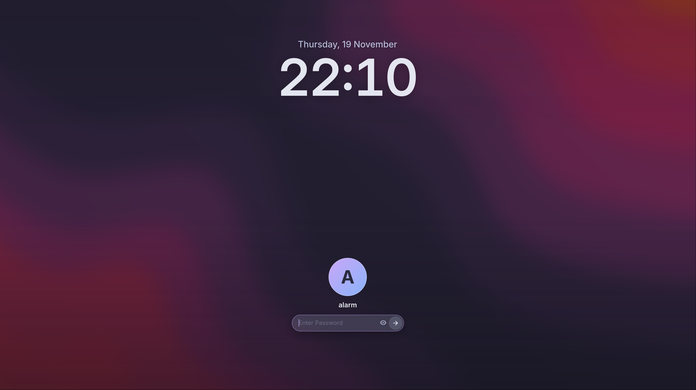

# locklet

A lock screen for river + [rivermonad](https://github.com/prietus/rivermonad),
in the family of [shotlet](https://github.com/prietus/shotlet),
[waymobar](https://github.com/prietus/waymobar) and
[bgmonad](https://github.com/prietus/bgmonad):

- it **locks with `ext-session-lock-v1`**, the protocol made for this: the
  compositor hides everything and gives the keyboard only to locklet. If
  locklet crashes or is killed the session stays locked (black); run
  `locklet` again to get the lock screen back;
- the screen **stays as it was for an instant and crossfades** to your
  wallpaper, **blurred and darkened, drifting slowly**. It is the one
  bgmonad shows on that output (asked with `bgmonad status`), so the desktop
  and the lock screen match; without bgmonad, `~/.config/wallpaper`;
- date and clock above; your picture, name and the password below. A wrong
  password shakes the field and says why (also when pam_faillock has
  locked the account for a while); on unlocking the desktop fades back in;
- every output gets the lock screen, also screens plugged in while locked;
- `locklet idle` locks after 10 minutes without input and before
  suspending, and can turn the screens off: no swayidle needed.



*The lock screen over the wallpaper that
[bgmonad](https://github.com/prietus/bgmonad) shows on the desktop, blurred
and darkened; it drifts slowly while locked.*

It is one Python file (GTK 4 and gtk4-layer-shell's session lock); the
password is checked with PAM through ctypes.

## Use

    locklet              lock
    locklet --preview    the lock screen in a window, without locking (Esc closes)

| | |
|---|---|
| `Enter` | unlock |
| `Esc` | clear the field |
| click anywhere | focus the field |

`kill -USR1 $(pidof -x locklet)` unlocks, for scripts. Running `locklet`
while it is locked does nothing.

In rivermonad and waymobar:

```haskell
  , ("M-S-l", spawn "locklet")                                   -- rivermonad
      , button "lock" "Lock" $ spawnOnClick "locklet" . text     -- waymobar's side panel
```

## Idle

`locklet idle` is the idle daemon: start it once with the session and it
locks after a while without input, before suspending or hibernating, and
can turn the screens off. It needs no swayidle:

```haskell
  startupHook = do
      spawnOnce "locklet idle"
```

```
locklet idle            start it (a new one replaces the one running: after editing the config)
locklet idle pause      stop locking for now (a film, a presentation)
locklet idle resume
locklet idle toggle     for a button in the bar
locklet idle status     active | paused | not running
```

It sleeps until the compositor says you are idle (`ext-idle-notify-v1`,
which also respects windows that ask the screen to stay on, like a video
player), so it costs nothing while it waits: one Python process of about
30 MB, no polling. Before sleeping it holds a logind *delay* inhibitor, so
the machine suspends once the lock screen is up, never before. The screens
are turned off with `wlr-output-power-management`.

Settings, in the same `config.json`:

```json
{
  "idle": {
    "lock": "10m",
    "screen_off": 0,
    "screen_off_locked": 0,
    "lock_before_sleep": true
  }
}
```

| | |
|---|---|
| `lock` | lock after this long without input: `600`, `"10m"`, `"1h"`; `0` never |
| `screen_off` | screens off after this long, locked or not; `0` never |
| `screen_off_locked` | screens off after this long on the lock screen (`"1m"` is what macOS does); `0` never |
| `lock_before_sleep` | lock before suspending or hibernating |

Any key or the mouse turns the screens back on.

## Settings

`~/.config/locklet/config.json`, every key optional (all of them with their
default values are in [examples/config.json](examples/config.json): copy it and
edit it):

```json
{
  "background": "wallpaper",
  "blur": 0.025,
  "dim": 0.38,
  "drift": true,
  "fps": 30,
  "fade": true,
  "clock": "%H:%M",
  "date": "%A, %-d %B",
  "avatar": "~/Pictures/me.jpg",
  "name": "",
  "pam_service": ""
}
```

| | |
|---|---|
| `background` | `"wallpaper"` (bgmonad's, else `~/.config/wallpaper`), `"screenshot"` (the screen itself), a path to an image, or a colour `"#1e1e2e"` |
| `blur` | radius as a fraction of the screen height; `0` sharp |
| `dim` | `0` the picture as it is, `1` black |
| `drift`, `fps` | the slow zoom and pan, and how often it is drawn |
| `fade` | start from a screenshot (needs grim) |
| `clock`, `date` | `strftime` formats; the date follows `LC_TIME` |
| `avatar` | else `~/.face`, AccountsService's icon or your initial |
| `name` | else the full name of the account, or the login |
| `pam_service` | else `locklet` if `/etc/pam.d/locklet` exists, else `login` |

`~/.config/locklet/style.css` is loaded after the built-in style (GTK CSS;
classes `locklet`, `date`, `clock`, `avatar`, `name`, `pill`, `go`,
`status`).

## Install

    pacman -S python-gobject gtk4 gtk4-layer-shell
    pacman -S python-pillow grim      # optional: blur with drift, crossfade
    git clone https://github.com/prietus/locklet ~/git/locklet
    ln -s ~/git/locklet/locklet ~/.local/bin/locklet
    sudo install -m644 ~/git/locklet/pam/locklet /etc/pam.d/locklet   # optional

Without `/etc/pam.d/locklet` it uses the `login` service, which is the same
on Arch. Both include **pam_faillock**: after 3 wrong passwords in 15
minutes the account is locked for 10 (the lock screen says so). `faillock
--user $USER --reset` clears it.

## License

BSD-3-Clause.
